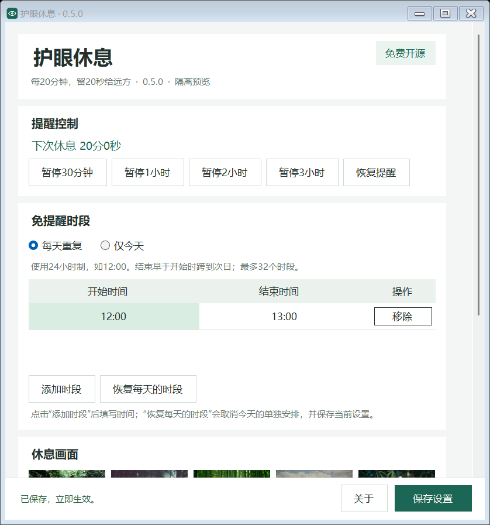

# 护眼休息 · EyeCare Break for Windows

每20分钟，留20秒给远方。免费开源的 Windows 原生休息提醒工具。

**永久免费，无试用期限，无购买入口，无支付组件，无授权文件检查。**



## 功能

- 每工作20分钟，显示20秒全屏休息提醒。
- 五张本地高清风景，开始及结束提示音和音量控制。
- 临时暂停30分钟、1小时、2小时或3小时。
- 每天重复或仅今天的免提醒时段，支持跨午夜。
- 托盘运行、可选登录电脑后自动运行。
- 锁屏到点后等待解锁，解锁后完整休息；睡眠恢复后重新计时。

## 下载与使用

到本仓库 Releases 下载 Windows ZIP，完整解压到固定目录，双击 `Open-EyeCare.cmd`。
关闭设置面板后继续在托盘运行；双击托盘图标打开设置，右键菜单可暂停、恢复或退出。
如开启自动运行，请保留解压目录；需要移动目录时先关闭该选项，移动后再开启。

需要 Windows 桌面环境和 .NET Framework 4.8。仅在实际测试过的 Windows 环境确认行为，其他版本和显示缩放请反馈问题。发行EXE暂未进行代码签名。

设置位于 `%APPDATA%\EyeCareBreak\native-settings.json`。旧版设置可继续读取；过往的授权文件无需移除，新版本不会读取它。
程序没有业务联网接口；图片和声音均从本地加载。自动运行只有在用户修改该选项并保存后才设置。

## 从源码构建

在 Windows PowerShell 中进入项目根目录运行：

```powershell
.\Build.ps1
.\dist\Open-EyeCare.cmd
```

输出目录默认 `dist`，已存在时拒绝覆盖。可指定 `.\Build.ps1 -Output .\dist-new`。
不需要 Node、Electron、npm 或下载 NuGet 包，声音和图片已包含在仓库。

## 开发验证

```powershell
New-Item -ItemType Directory -Path .\test-output
Start-Process .\dist\EyeCareBreak.exe -ArgumentList '--self-test test-output\core.json' -Wait
Start-Process .\dist\EyeCareBreak.exe -ArgumentList '--candidate --data-dir test-output\data --qa-dir test-output\ui' -Wait
```

检查 JSON 的 `failed=0` 和 `passed=true`。隐藏UI测试使用隔离设置，不更改正式启动项；它不替代真实锁屏、睡眠、多屏及音效主观验收。

## 来源与许可证

这是基于 [Stretchly](https://github.com/hovancik/stretchly) 本地派生工程发展而来的独立 Windows 原生实现，**不是 Stretchly 官方发行版**。包含AI辅助开发的代码。
保留上游 BSD-2-Clause 许可证与版权声明，新增代码沿用相同许可证。
照片使用各自的 Unsplash 许可，不由代码许可证重新授权。声音、图标和派生关系见 [第三方说明](THIRD_PARTY_NOTICES.md)。

当前版本：0.5.0。只提供休息提醒，不承诺医疗或视力改善效果。
